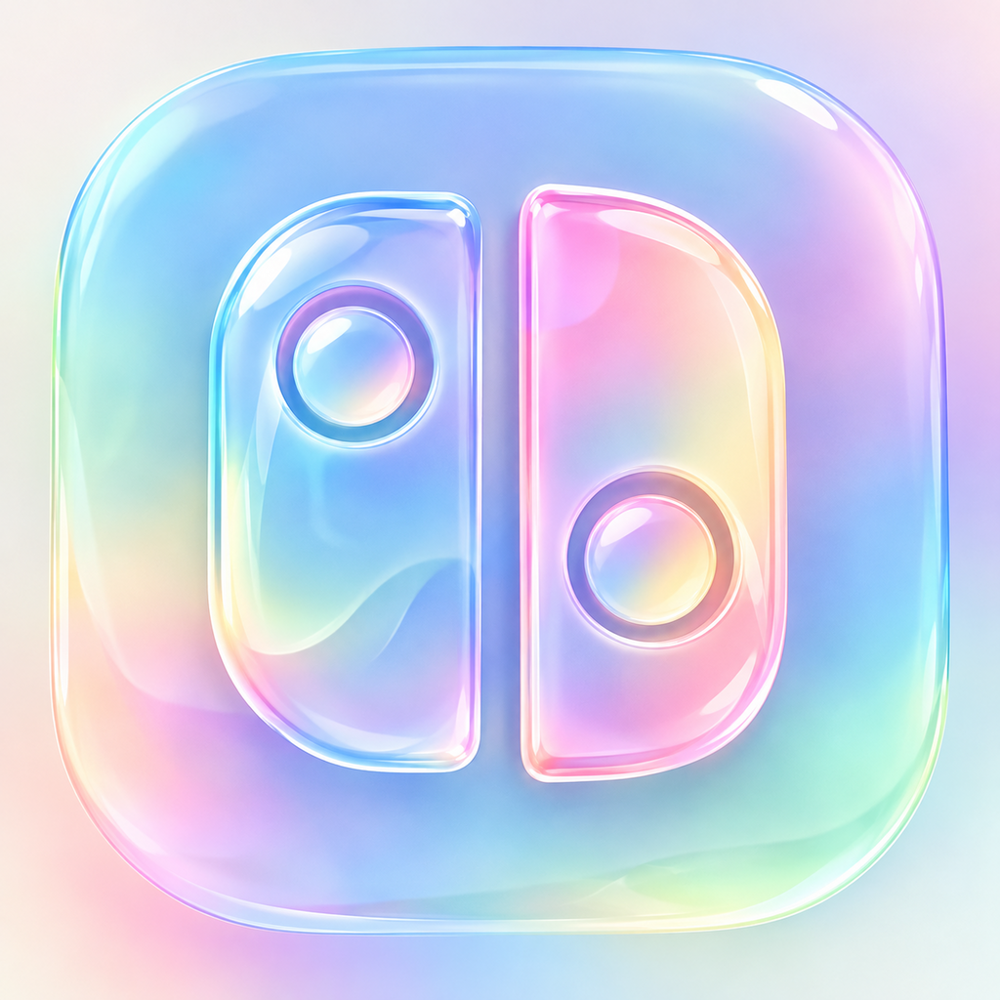

  

<h1 align="center">Candela</h1>

  A Nintendo Switch emulator for iPhone and iPad, tuned for iPhone 15 class hardware.

> **Unofficial fork.** Candela is not affiliated with the MeloNX team, the MeloVertex project or the Ryujinx team. Please do not ask any of them for support with Candela. Report Candela problems on [this repository's issues](https://github.com/gavin02031/VortexClub/issues).

## What is Candela?

Candela is an open-source iOS Switch emulator written mostly in C# and Swift. It is a fork of [MeloVertex](https://github.com/VertexSelection/MeloVertex), which is a fork of [MeloNX](https://git.ryujinx.app/projects/MeloNX), which is built on [Ryujinx](https://git.ryujinx.app/ryubing/ryujinx). The goal is a smoother, simpler experience on newer iPhones, starting with a handful of demanding games: The Legend of Zelda: Tears of the Kingdom, Super Mario Odyssey and Tomodachi Life: Living the Dream.

Candela is free software. The license that applies is the one in [LICENSE.txt](LICENSE.txt): the GNU Affero General Public License version 3 or later, inherited from MeloNX and Ryujinx.

## What is different from MeloVertex

- Built-in starting presets for Tears of the Kingdom, Super Mario Odyssey and Tomodachi Life. They apply only when you have not saved your own per-game settings for that title, and they never overwrite your global settings. Your saved per-game settings always win.
- Shader cache and macro HLE are on by default.
- A GitHub Actions workflow that builds an unsigned IPA, so you can build without a Mac (see "Building" below).
- The app is renamed to Candela. The bundle identifier is unchanged, so a sideloaded copy keeps its existing settings and does not collide with the original MeloNX.

The presets are starting points. Performance depends on the game, the scene and your device, and none of the preset values have been benchmarked yet. Treat them as a first guess and adjust per game.

## Important

- If a game crashes, turn on **Ignore Missing Services** in Advanced Settings.
- Candela **requires** JIT and cannot run without it.
- Candela keeps the same bundle identifier as the MeloVertex fork, so installing it can replace an existing MeloVertex install. It does not replace the original MeloNX.

## Device notes

- Recommended iPhone: iPhone 15 Pro or newer. iPhones with 8 GB or 12 GB of RAM share the same 6 GB per-app memory limit.
- Recommended iPad: iPad Pro (5th generation or newer) with 128 GB or more, or iPad Air 5 or newer.
- Lowest compatible device with a paid developer account: iPhone 6s (iOS 15). With a free developer account: iPhone 12.

## Entitlements

Entitlements are permissions that iOS gives an app. Candela can use two:

**Increased Memory Limit** lets the app use as much RAM as Apple allows. It is required on all devices.

**Extended Virtual Addressing** lets the app ask iOS for more address space than the device has RAM. It is a paid-account entitlement (TrollStore can also provide it). It is required on iPads with less than 8 GB of RAM and iPhones with less than 4 GB of RAM.

## Installing

Candela is distributed as an IPA that you sign and install yourself. Use a sideloader that keeps the `get-task-allow` entitlement, because JIT needs it. SideStore does this. Some signers strip it.

1. **Get the IPA.** Build it with the workflow described in "Building", or use a release if one is published on this repository.
2. **Sideload it** with [SideStore](https://sidestore.io/), [Sideloadly](https://sideloadly.io/), [PlumeImpactor](https://github.com/khcrysalis/PlumeImpactor/releases) or another Apple ID sideloader.
3. **Enable Increased Memory Limit.** With a paid developer account, enable `Increased Memory Limit` (and `Extended Virtual Addressing` if you need it) for the app's identifier at [Apple Developer Identifiers](https://developer.apple.com/account/resources/identifiers), then reinstall. With a free account, use the [Entitlement app](https://github.com/hugeBlack/GetMoreRam/releases/download/nightly/Entitlement.ipa), or the PlumeImpactor method. Check inside Candela that Increased Memory Limit shows as enabled.
4. **Add keys and firmware** with the file picker inside Candela. The links under "FAQ" explain how to dump them from your own Switch.
5. **Enable JIT** every time you launch. [StikDebug](https://github.com/StikDebug/StikDebug) is the usual on-device method on iOS 26 and newer. Pair it with a pairing file generated in SideStore, then launch Candela through StikDebug. Candela can open StikDebug for you. If JIT does not attach, check that the StikDebug version you have supports your iOS version.

## Building

This repository has a manual workflow, **Build unsigned iOS IPA** (`.github/workflows/ios-unsigned-ipa.yml`). Open the Actions tab, pick the workflow, choose the branch and run it. It publishes the C# core for `ios-arm64`, builds the app with Xcode without signing, and uploads an artifact named `MeloVertex-unsigned-ipa`. The artifact name still carries the old name for now. Download it and sign it with your sideloader. The workflow runs on GitHub's macOS runners and uses your free build minutes.

## FAQ

**Does Candela support Tomodachi Life: Living the Dream?**
That support is inherited from the MeloVertex fork. If it crashes, turn on Ignore Missing Services.

**Where do I get prod.keys, or a game?**
This project does not help with that and does not support piracy.

**Do I need a Switch?**
To play commercial games you need a Switch that can run custom firmware, so you can dump your own firmware, keys and legally purchased games. The emulator also runs many homebrew applications.

**How do I dump firmware, games and keys?**
First hack your own Switch with the [Switch guide](https://nh-server.github.io/switch-guide/). Then follow the Ryubing guides:

[Keys](https://git.ryujinx.app/ryubing/ryujinx/-/wikis/Dumping/Keys) 
[Games, Updates and DLC](https://git.ryujinx.app/ryubing/ryujinx/-/wikis/Dumping/Games,-Updates-&-DLC) 
[Firmware](https://git.ryujinx.app/ryubing/ryujinx/-/wikis/Dumping/Firmware)

## Features

These come from MeloNX and Ryujinx.

- **Audio:** audio output is supported; microphone input is not. OpenAL via C# wrappers, with SDL2 and libsoundio as fallbacks.
- **CPU:** the ARMeilleure CPU emulator covers most 64-bit ARMv8 instructions and some 32-bit ones. It supports a persistent translation cache, so launch the game at least twice to the title screen or beyond before load times improve.
- **GPU:** the Maxwell GPU is emulated on Metal, through MoltenVK and a custom build of Silk.NET.
- **Input:** keyboard, touch, Joy-Con and nearly all MFi controllers. Motion controls work in most cases (not on Joy-Con, due to an iOS limit). Rumble works in most cases.
- **DLC and updates:** DLC and game update add-ons are supported. Mods (romfs, exefs, cheats) are unsupported but may work.
- **Configuration:** logging, controller mapping, resolution, shader cache and more.

## Notice

This project does not distribute, include or endorse any copyrighted or pirated content. The software is provided for legitimate and lawful use.

Users are solely responsible for making sure that any copyrighted material they use with this software (including ROMs, cryptographic keys and firmware) is obtained legally and in accordance with applicable law. The developers disclaim all responsibility for misuse of the software or for any legal consequences of using illegally obtained content.

Any third-party distribution of this emulator bundled with copyrighted content (including ROMs, cryptographic keys and firmware) is done without permission and is not associated with or endorsed by this project.

Nintendo Switch and Nintendo are trademarks of Nintendo Co., Ltd. Pokémon is a trademark of Nintendo, Creatures Inc. and Game Freak Inc. Animal Crossing is a trademark of Nintendo Co., Ltd.

This project is an independent, third-party work and is not affiliated with, endorsed by or associated with Nintendo Co., Ltd., any of its subsidiaries, or any other console manufacturer or game publisher.

## License

This software is licensed under the terms in [LICENSE.txt](LICENSE.txt) (GNU Affero General Public License version 3 or later). Earlier MeloNX and MeloVertex documentation called this GPLv3. If you redistribute Candela, follow the license text in that file.

This project uses code from the libvpx project, licensed under BSD, and the ffmpeg project, licensed under LGPLv3.

See [LICENSE.txt](LICENSE.txt) and [THIRDPARTY.md](distribution/legal/THIRDPARTY.md) for details.

## Credits

- [MeloVertex](https://github.com/VertexSelection/MeloVertex) by VertexSelection, the fork Candela comes from.
- [MeloNX Team](https://git.ryujinx.app/projects/MeloNX) for MeloNX.
- [Ryujinx](https://git.ryujinx.app/ryubing/ryujinx) (Ryubing), the emulator MeloNX is based on.
- [StikDebug](https://github.com/StikDebug/StikDebug) for on-device JIT enablement.
- [LibHac](https://github.com/Thealexbarney/LibHac) for the file system.
- [AmiiboAPI](https://www.amiiboapi.com) for Amiibo emulation.
- [ldn_mitm](https://github.com/spacemeowx2/ldn_mitm) for one of the multiplayer modes.
- [ShellLink](https://github.com/securifybv/ShellLink) for Windows shortcut generation.
